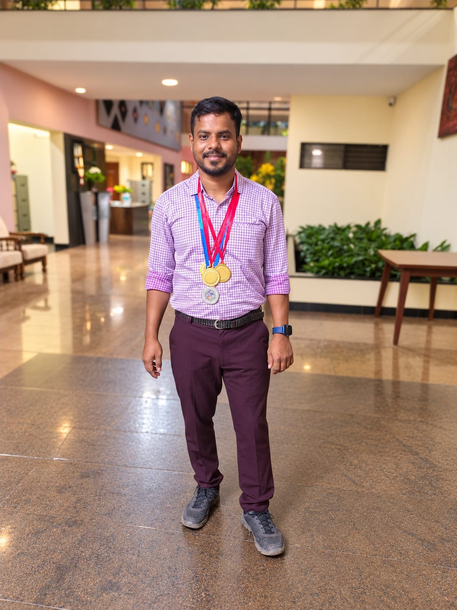

Away from mathematics, I enjoy sport and participating in campus life.

- Represented IIT Goa in cricket at the Inter-IIT Sports Meets at IIT Gandhinagar (2023) and IIT Kanpur (2024).
- Gold medals in the Swachata Seva Marathon and cricket competitions at IIT Goa (2025).
- Silver medal in badminton at IIT Goa (2025) and volleyball (2023).
- First prize in the Hindi Pakhwada debate competition at IIT Goa (2023).
- Organizer of the Research Scholars’ Confluence at IIT Goa (2020).
- Third prize for the poster “Timeline of Indian Mathematicians” at IIT Goa (2021).

[Back to research](../research/)
